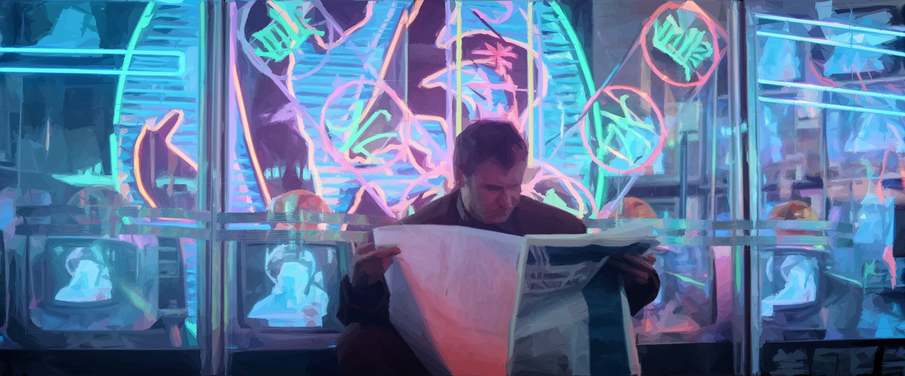

# Tri-Klops

Create images from triangles using a genetic algorithm.


## Installation

Download the latest release from the [releases page](https://github.com/kkestell/tri-klops/releases) on GitHub.

## Build and run

Install Rust with [rustup](https://rustup.rs/), then run these commands from the checkout.

```sh
rustup update stable
cargo run --release --locked
```

Load a reference image and choose **Start Processing**. The preview shows the best candidate over the accepted triangles. When the run finishes, or when you stop it, Tri-Klops saves an SVG next to the reference image using the same filename stem. An existing SVG at that path is replaced.

### Shaping the triangles

Raise **Chunkiness** to rule out skinny triangles. Increase **Grid snap** to make corners land on shared grid points. At 0% chunkiness and 1 px spacing, the generator has full freedom. Choose **Start Processing** to use the new settings. [See these controls on The Great Wave](#the-great-wave-off-kanagawa).

## Benchmark

```sh
cargo bench --locked --bench approximation
cargo bench --locked --bench approximation -- --defaults
```

The first command runs all four bundled 256×256 images with seeds 7, 42, and 101. Each run allows 32 triangles, 12 generations per triangle, 48 candidates per generation, and 12 parents. The second command runs Castle with seed 42 and the application's default settings of 512 triangles, 256 generations, 128 candidates, and 64 parents.

Both commands report wall time from the start of approximation through the SVG write, plus the final canvas's mean squared RGB error against the reference. Lower error means a closer pixel match. Image decoding, compilation, and GUI rendering are outside the timer. The generated SVGs are in `target/approximation-bench/`.

On an Apple M4 with Rust 1.100.0, the following release-build measurements compare the original generator at `1021a8b` with the generator at `20bef7f`. For the quality check, librsvg 2.63.2 independently rasterized each saved SVG at 256×256. The table reports mean squared error against the decoded source JPEG.

| Workload | Original time | Updated time | Speedup | Original SVG error | Updated SVG error |
| --- | ---: | ---: | ---: | ---: | ---: |
| Four images × three seeds, mean per run | 249 ms | 20.8 ms | 12.0× | 2,000.7 | 883.7 |
| Castle, defaults, seed 42 | 195.0 s | 3.84 s | 50.8× | 351.1 | 136.7 |

A further optimization on the same M4 reduced the short benchmark from 18.8 ms to 2.68 ms per image (7.0×) and Castle at defaults from 3.82 s to 0.797 s (4.8×). These are medians of five runs per version, alternating between `20bef7f` and the current build. All 13 generated SVGs matched byte for byte.

## Package a release

- On macOS, run `./publish-macos.sh` with the Xcode command-line tools installed to build the Intel and Apple Silicon app and zip archive.
- On x64 Windows, install Inno Setup 6 and run `.\install.ps1` in PowerShell to create the installer in `publish\`.

## Examples

All runs use seed 42. Deckard, Zardoz, and The Great Wave use 1024×1024 canvases and a 4,096-triangle budget.

### Deckard


[Reference crop](./examples/deckard-reference.jpg) · [512-triangle render at 256×256](./examples/deckard-512.jpg) · [Full-size SVG](./examples/deckard.svg) · [Film still via Scene Still](https://www.scenestill.com/storage/film-stills/webp/vlcsnap-2026-01-31-12h40m01s195_webp.webp)

### Zardoz


[Reference image](./examples/zardoz.jpg) · [512-triangle render at 256×256](./examples/zardoz-512.jpg) · [Full-size SVG](./examples/zardoz.svg)

### The Great Wave off Kanagawa


This render uses 90% **Chunkiness** and 16 px **Grid snap**.

[Reference image](./examples/kanagawa.jpg) · [Free-placement render](./examples/kanagawa-render.jpg) · [Full-size SVG](./examples/kanagawa-styled.svg) · [Free-placement SVG](./examples/kanagawa.svg)

### J. Robert Oppenheimer


The 1280×1635 render uses a 12,288-triangle budget and preserves the framing of Philippe Halsman’s 1958 portrait.

[Reference photograph via Magnum Photos](https://content.magnumphotos.com/wp-content/uploads/2019/05/cortex/par196080-teaser-story-big.jpg) · [Full-size SVG](./examples/oppenheimer.svg)

### Blade Runner in neon



The 1920×800 render uses free vertex placement and 320 search generations per triangle. The 16,384-triangle budget produced 12,955 triangles.

[Film still via Scene Still](https://www.scenestill.com/storage/film-stills/webp/vlcsnap-2026-01-31-12h33m14s004_webp.webp) · [Full-size SVG](./examples/blade-runner-neon.svg)
