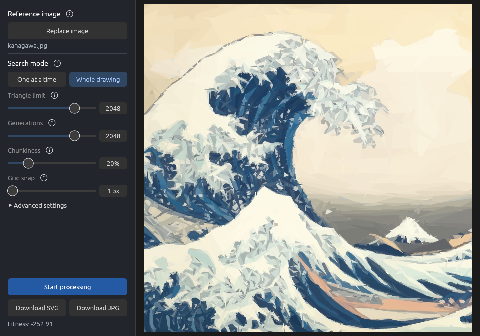
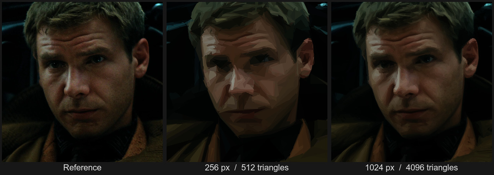
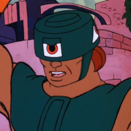
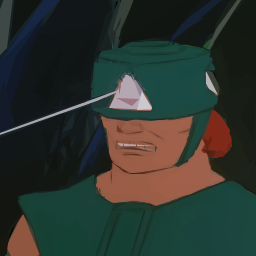
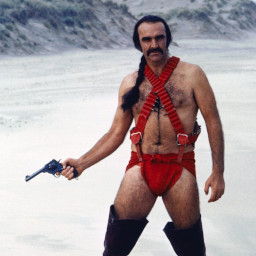
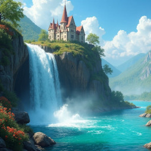
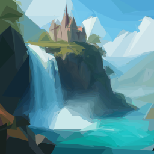
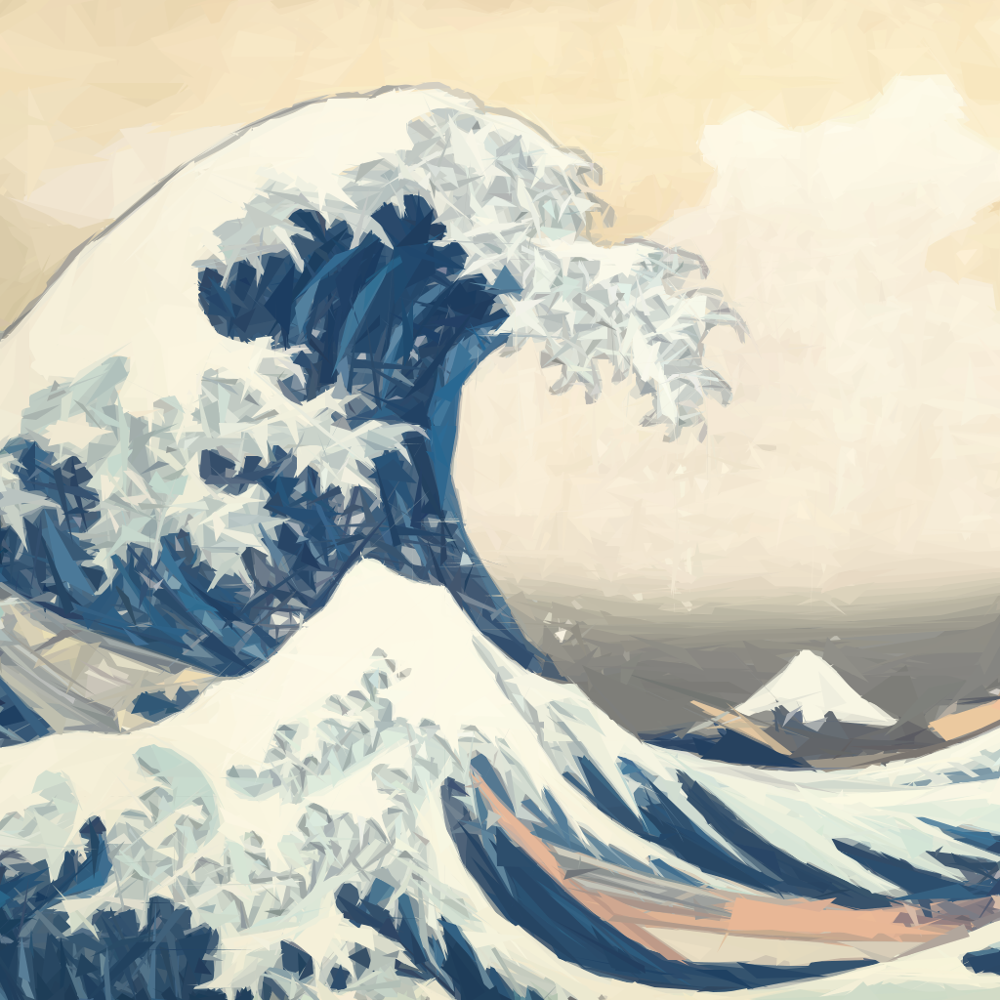

# Tri-Klops

Create images from triangles using a genetic algorithm.

<p align="center">
    
</p>

## Deckard in 4,096 triangles



At 4,096 triangles, the crease across Deckard’s forehead and the contours around his eyes come into focus. [Open the full-size SVG](examples/deckard.svg) · [Original 1982 film still via Scene Still](https://www.scenestill.com/storage/film-stills/webp/vlcsnap-2026-01-31-12h40m01s195_webp.webp)

| Canvas | Triangles | Time on Apple M4 | Mean squared RGB error |
| --- | ---: | ---: | ---: |
| 256×256 | 512 | 3.86 s | 45.71 |
| 1024×1024 | 4,096 | 47.0 s | 24.47 |

Both runs used the same square crop and seed 42. Rendering both SVGs at 1024×1024 and comparing them to the same reference showed **46.5% lower error** for the larger run.

## Installation

Download the latest release from the [releases page](https://github.com/kkestell/tri-klops/releases) on GitHub.

## Build and run

Install Rust with [rustup](https://rustup.rs/), then run these commands from the checkout.

```sh
rustup update stable
cargo run --release --locked
```

Load a reference image and choose **Start Processing**. The preview shows the best candidate over the accepted triangles. When the run finishes, or when you stop it, Tri-Klops saves an SVG next to the reference image using the same filename stem. An existing SVG at that path is replaced.

## Benchmark

```sh
cargo bench --locked --bench approximation
cargo bench --locked --bench approximation -- --defaults
```

The first command runs all four bundled 256×256 images with seeds 7, 42, and 101. Each run allows 32 triangles, 12 generations per triangle, 48 candidates per generation, and 12 parents. The second command runs Castle with seed 42 and the application's default settings of 512 triangles, 256 generations, 128 candidates, and 64 parents.

Both commands report wall time from the start of approximation through the SVG write, plus the final canvas's mean squared RGB error against the reference. Lower error means a closer pixel match. Image decoding, compilation, and GUI rendering are outside the timer. The generated SVGs are in `target/approximation-bench/`.

On an Apple M4 with Rust 1.100.0, the following release-build measurements compare the original generator at `1021a8b` with the updated generator. For the quality check, librsvg 2.63.2 independently rasterized each saved SVG at 256×256. The table reports mean squared error against the decoded source JPEG.

| Workload | Original time | Updated time | Speedup | Original SVG error | Updated SVG error |
| --- | ---: | ---: | ---: | ---: | ---: |
| Four images × three seeds, mean per run | 249 ms | 20.8 ms | 12.0× | 2,000.7 | 883.7 |
| Castle, defaults, seed 42 | 195.0 s | 3.84 s | 50.8× | 351.1 | 136.7 |

## Package a release

- On macOS, run `./publish-macos.sh` with the Xcode command-line tools installed to build the Intel and Apple Silicon app and zip archive.
- On x64 Windows, install Inno Setup 6 and run `.\install.ps1` in PowerShell to create the installer in `publish\`.

## Examples

<table>
  <thead>
    <tr>
      <th>Reference Image</th>
      <th>Output Image</th>
    </tr>
  </thead>
  <tbody>
    <tr>
      <td>
          
      </td>
      <td>
          
      </td>
    </tr>
    <tr>
      <td>
          
      </td>
      <td>
          
      </td>
    </tr>
    <tr>
      <td>
          
      </td>
      <td>
          
      </td>
    </tr>
    <tr>
      <td>
          
      </td>
      <td>
          
      </td>
    </tr>
  </tbody>
</table>
